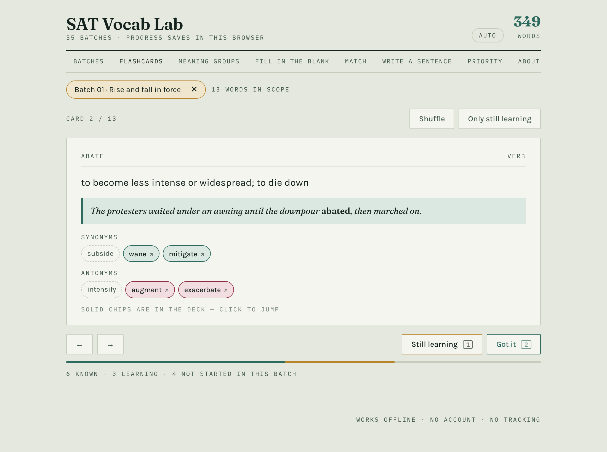
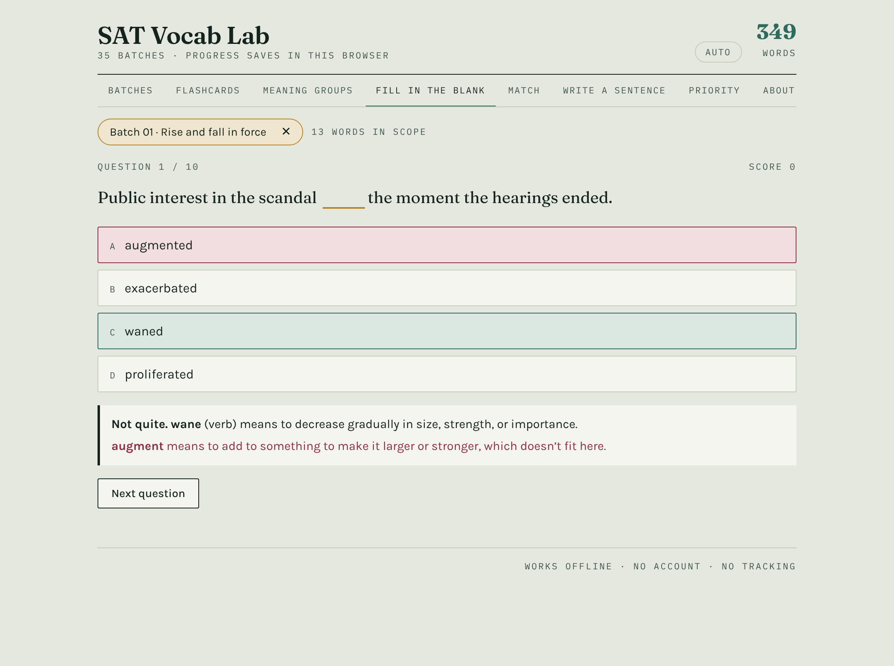
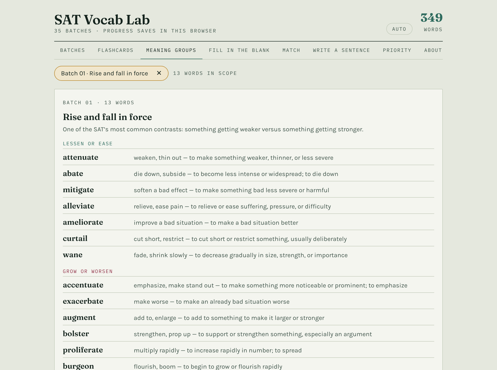
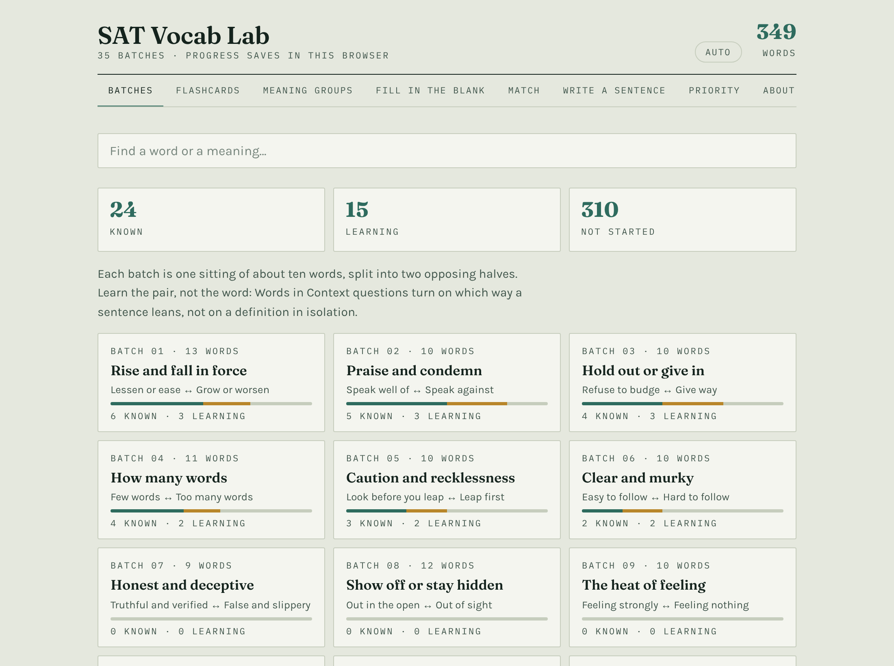
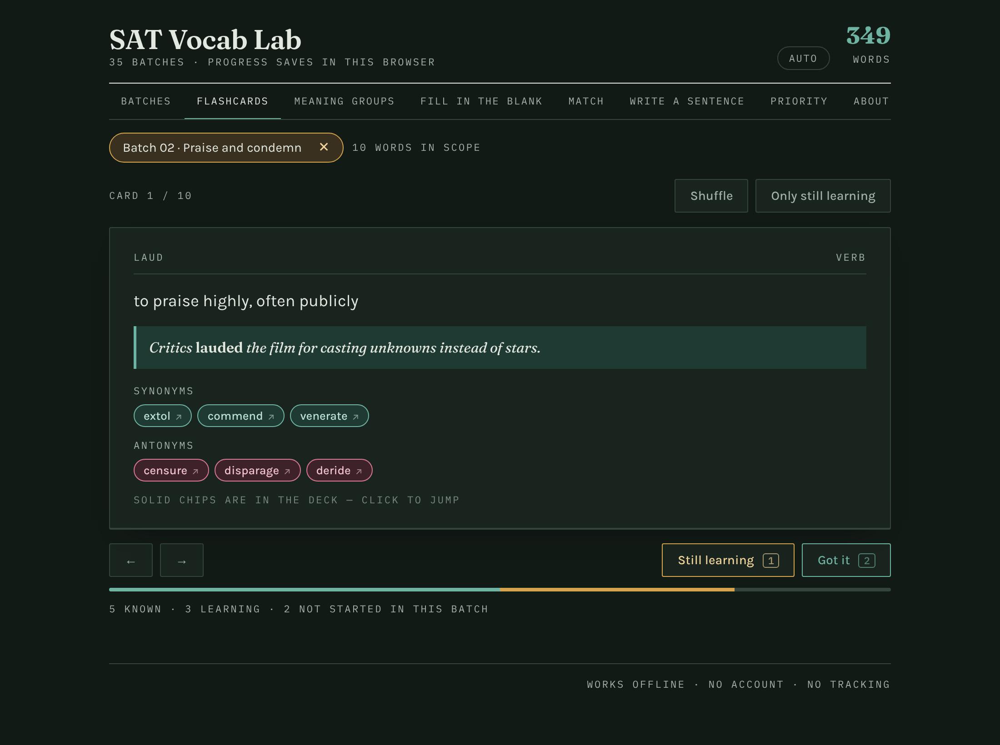

# SAT Vocab Lab

[](https://github.com/Ishaan7497/SAT-VOCAB-LAB/actions/workflows/deploy.yml)
[](LICENSE)


**An SAT vocabulary trainer built around opposites.** 349 words in 35 themed batches, each split into two opposing halves, because the digital SAT's Words in Context questions turn on which way a sentence leans, not on a definition alone.

**[Try it live →](https://ishaan7497.github.io/SAT-VOCAB-LAB/)** · [Design notes](docs/DESIGN.md) · [Run it locally](#run-it-locally)



| 349 words | 35 study batches | 672 linked synonyms and antonyms | 7 study modes | 0 dependencies |
| :---: | :---: | :---: | :---: | :---: |

## Contents

- [Why I built this](#why-i-built-this)
- [The problem](#the-problem)
- [How it works](#how-it-works)
- [Features](#features)
- [Engineering](#engineering)
- [Testing](#testing)
- [Accessibility and privacy](#accessibility-and-privacy)
- [Run it locally](#run-it-locally)
- [Adding words](#adding-words)
- [Roadmap](#roadmap)
- [How this was built](#how-this-was-built)
- [Sources and credits](#sources-and-credits)

## Why I built this

## The problem

On the digital SAT, vocabulary is tested only one way: a sentence with a blank and four choices. The hardest wrong answers are usually words from the right topic that point the wrong way. A student who knows *mitigate* and *exacerbate* are "something about severity" still loses the point.

Flashcard decks sorted alphabetically or by difficulty don't train that distinction. This one is built to.

## How it works

- **Antonym-paired batches.** Each batch of about ten words is one study sitting, split into opposing halves: *abate, mitigate, curtail* against *exacerbate, augment, proliferate*. Words are always studied beside the words they're most easily confused with.
- **A connected deck.** 672 synonym and antonym links point to other cards, so one word leads to its neighbours.
- **Quiz questions that test direction.** Wrong options come from the word's own opposite half first and are inflected to match the sentence, so the only way to answer is to read the sentence's logic.
- **Priorities from evidence.** A Priority view ranks words by how often they appeared in official Bluebook practice tests.

<table>
<tr>
<td width="50%"><br><sub><b>Fill in the blank.</b> All four options fit the topic and the tense; only one fits the sentence's direction.</sub></td>
<td width="50%"><br><sub><b>Meaning groups.</b> Each batch shown as its two halves.</sub></td>
</tr>
<tr>
<td width="50%"><br><sub><b>Batches.</b> One sitting each, with progress saved in the browser.</sub></td>
<td width="50%"><br><sub><b>Dark mode,</b> following the system setting.</sub></td>
</tr>
</table>

## Features

| Mode | What it does |
| --- | --- |
| Batches | 35 study sittings with progress, plus search across words and definitions. Choosing a batch filters every other mode. |
| Flashcards | Definition, example sentence, linked synonyms and antonyms. Keyboard: `space` flip, `←` `→` move, `1` still learning, `2` got it. |
| Meaning groups | Each batch laid out by its two halves. |
| Fill in the blank | SAT-style questions with tense-matched, same-topic distractors. Missed words are marked for review. |
| Match | Pair words with short meanings, drawn from words not yet mastered. |
| Priority | Bluebook frequency ranking, transition words by category, and the verbs used in "function of the sentence" questions. |

Also: dark mode, works on phones, works offline, no account, no tracking.

## Engineering

- **No framework, no build step.** Plain HTML, CSS and JavaScript. Opens straight from the file system and deploys to GitHub Pages unchanged.
- **Testable core.** Logic that doesn't touch the page (inflection, question generation, progress) lives in [`js/core.js`](js/core.js). Unit tests load the same files the browser runs.
- **Tests that check the data, not just the code.** One test confirms that all 349 example sentences use a word form the quiz can reproduce. It caught two real bugs (*extol*, *demur*) that had been showing quiz options in the wrong tense.
- **Data validation.** [`scripts/validate.mjs`](scripts/validate.mjs) rejects duplicate words, missing fields, and example sentences the quiz can't blank.
- **Continuous integration.** Every push runs the tests and validator on GitHub Actions, then deploys to GitHub Pages. A failing check blocks the deploy.
- **Self-hosted fonts** (SIL Open Font License), so the site makes no third-party requests.

```
index.html               page shell
css/styles.css           styles and light/dark theme tokens
js/data.js               the deck: batches, priority lists, frequency data
js/core.js               pure logic: inflection, question building, progress
js/app.js                rendering and interaction
test/                    unit tests (node:test)
scripts/validate.mjs     deck integrity checks
scripts/screenshots.py   regenerates the images in this README
docs/DESIGN.md           design decisions and trade-offs
.github/workflows/       CI: test, validate, deploy
```

The reasoning behind each decision is in **[docs/DESIGN.md](docs/DESIGN.md)**.

## Testing

```bash
npm test
```

Runs ten unit tests with Node's built-in test runner, then the deck validator. The tests cover:

- verb inflection, including irregular and doubled-consonant forms (*propel → propelled*, *gainsay → gainsaid*);
- that every one of the 349 example sentences highlights a form the quiz can reproduce;
- that every word yields a question with four distinct options and exactly one correct answer;
- that no wrong option is a listed synonym of the answer, and that wrong options prefer the opposite half of the same batch;
- progress counting and shuffling.

## Accessibility and privacy

- Study modes follow the WAI-ARIA tabs pattern, so arrow keys move between them; every mode works from the keyboard.
- Quiz feedback is announced to screen readers, and the flashcard hides its off-screen face from assistive technology.
- Animation is reduced when the operating system asks for it.
- Progress is stored only in the browser's `localStorage`. There is no account, no analytics, and no request to any server.

## Run it locally

```bash
git clone https://github.com/Ishaan7497/SAT-VOCAB-LAB.git
cd SAT-VOCAB-LAB
npm start          # serves the site locally; or just open index.html
npm test           # unit tests + deck validation (Node 18+)
```

## Adding words

Every word is one entry in [`js/data.js`](js/data.js):

```js
{w:'abate', pos:'verb', p:1,
 def:'to become less intense or widespread; to die down',
 gist:'die down, subside',
 ex:'The protesters waited until the downpour <b>abated</b>, then marched on.',
 syn:['subside','wane','mitigate'], ant:['intensify','augment','exacerbate']},
```

`p` is the half of the batch (1 or 2). Wrap the word in `<b>…</b>` in the exact form the sentence uses; the quiz blanks it and inflects the other options to match. Run `npm test` before committing.

## Roadmap

- **Spaced repetition.** "Still learning" currently only filters. Storing when each word was last seen would let the app bring words back on a schedule.
- **A second sentence per word.** The quiz reuses the flashcard sentence, so a drilled batch becomes recognisable. A held-out test sentence would make the quiz a cleaner measure.
- **Measure whether the pairing helps.** The design rests on a hypothesis: that learning words against their opposites improves Words in Context accuracy. A small comparison against an alphabetical deck would test it.

## How this was built

## Sources and credits

- Definitions and example sentences are original to this project.
- Bluebook frequency counts: [3-4-5 Tutoring's analysis](https://345tutoring.wordpress.com/dsat-vocabulary-high-frequency-words-to-know/) of Bluebook practice tests 4–10 and the Medium/Hard Question Bank — a third-party compilation, not an official College Board list.
- Fonts: Fraunces, Karla and IBM Plex Mono, via Fontsource, under the SIL Open Font License (see [`fonts/`](fonts/)).

*SAT and Bluebook are trademarks of the College Board, which is not affiliated with and does not endorse this project.*

## License

[MIT](LICENSE) © 2026 Ishaan Gupta
